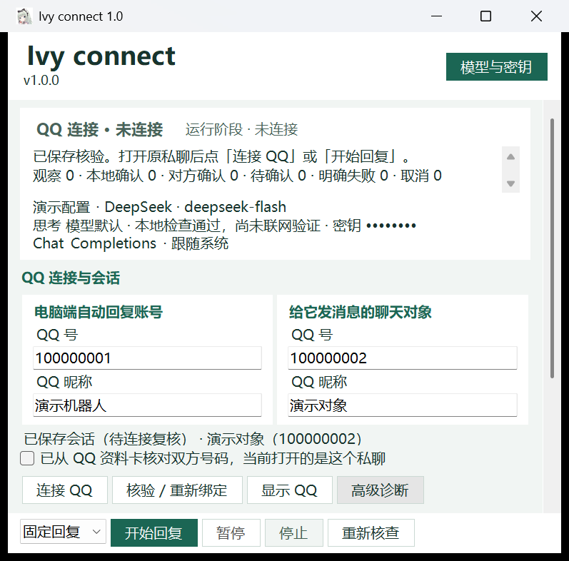

# Ivy connect 1.0

Ivy connect 基于官方 Windows QQ 客户端，在一个已经核验的私聊中读取新来信并回复。支持固定回复、多模型配置、图片遮罩和本地发送结果核查。

## 下载和启动

在 [v1.0.0 Release](../../releases/tag/v1.0.0) 下载 `Ivy-connect-v1.0.0-win-x64.zip`。解压整个文件夹，进入 `Ivy connect 1.0` 双击 **Ivy connect.exe**。这个包内含 .NET 10 Windows Desktop 运行库。开发者可下载同页的 `Ivy-connect-v1.0.0-source-mit.zip`，其中包含本次开源更新和完整许可证。v0.8.0 的单文件实验仍按历史材料保留。

1. 安装并登录官方 Windows QQ。把允许自动回复的私聊打开，保持窗口展开。
2. 在主界面填写**电脑端自动回复账号**和**给它发消息的聊天对象**。点击「连接 QQ」。如果 APP 要求核验，用界面指明的聊天对象账号向电脑端回复账号发送显示的五位数字。
3. 从「模型与密钥」选择或新增配置，填写该 API 地址、模型名和密钥。可先连接测试。可选角色和上下文限额也在这里设置。默认跟随系统网络，按需改为直连或填入自己已有的 HTTP 代理。可用的思考设置由接口和模型能力决定。切换配置后停止并重新开始，才会用于新一轮运行。
4. 连接并核验通过后点击「开始回复」。运行中可点击「暂停」或「停止」。退出前先停止。图片遮罩覆盖仍展开的 QQ 聊天窗口，可从主窗或托盘显示 QQ、关闭遮罩及恢复位置。

## 数据、升级与恢复

本机数据目录是 `%LOCALAPPDATA%\QQPrivateApp\phase3`。「高级诊断」提供打开和备份入口。日志为 `app.log`，模型和密钥在 `model-profiles.dpapi`，历史单配置可保留为 `model-settings.dpapi`。绑定、上下文、发送和去重状态保存在 `private-state.dpapi`。自选遮罩在 `qq-cover.user.png`。

第一次运行 1.0 会在用户数据目录上级的 `备份\首次使用-v1.0.0` 保存并校验已有数据文件。升级或恢复前，先停止并在托盘退出已有 Ivy connect。桌面版、备份版和近期历史版共用控制互斥和数据目录。恢复程序时解压完整的原版运行包，优先继续使用最新账本。DPAPI 加密数据与原 Windows 用户相关，迁移到其他用户或电脑需要重新填写密钥和核验会话。

如果提示待确认，优先对原任务「重新核查」。有对端收件证据时可使用人工确认入口。程序区分本地气泡和对端收件。未决任务跨重启保留，重复启动、重新核查和人工确认都不会自动重发该任务。

## 验证范围与限制

- v1.0.0 使用 v0.8.0 的 QQ 收发与模型逻辑，并沿用原有绑定、状态和密钥存储。详见 [正式验收](docs/正式验收.md)。
- v0.8.0 的本机记录包含 DeepSeek 真实调用、两轮上下文，以及单个授权私聊的机器人端本地确认和对方收件确认。其他厂商预设或模拟测试不等于真实 API 已验证。
- 一次只处理一个核验通过的文字私聊。真正最小化发送、群聊、多联系人路由、其他 Windows 架构和长期运行稳定性仍超出已验证范围。

## 许可

Ivy connect 的源代码、项目所有者授权的原始软件图标、默认遮罩和自有品牌图片采用 [MIT License](LICENSE)，Copyright (c) 2026 chernobyledk。第三方组件和资源沿用各自的许可证及版权声明。详见 [第三方与资源声明](docs/THIRD_PARTY_NOTICES.md)。

## 开发

需 Windows x64 和 .NET 10 SDK。本版构建使用 10.0.404 SDK，锁定 Windows Desktop 运行库 10.0.15。参见 [构建说明](docs/构建.md)、[版本索引](docs/历史版本.md)和[第三方许可](docs/THIRD_PARTY_NOTICES.md)。
